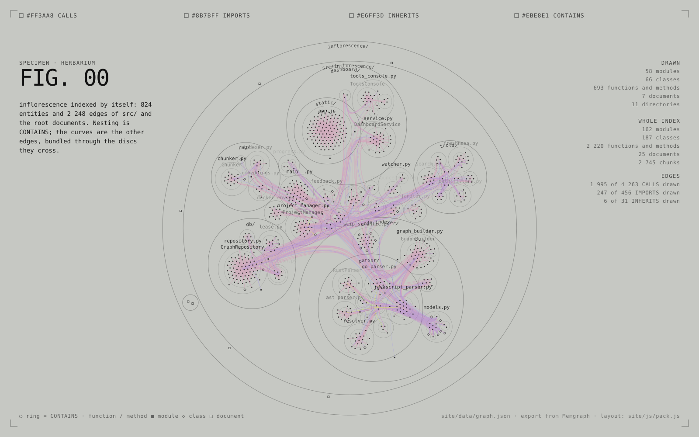
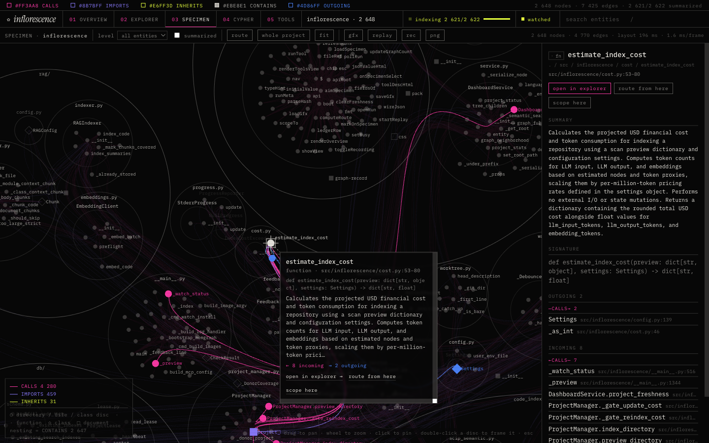
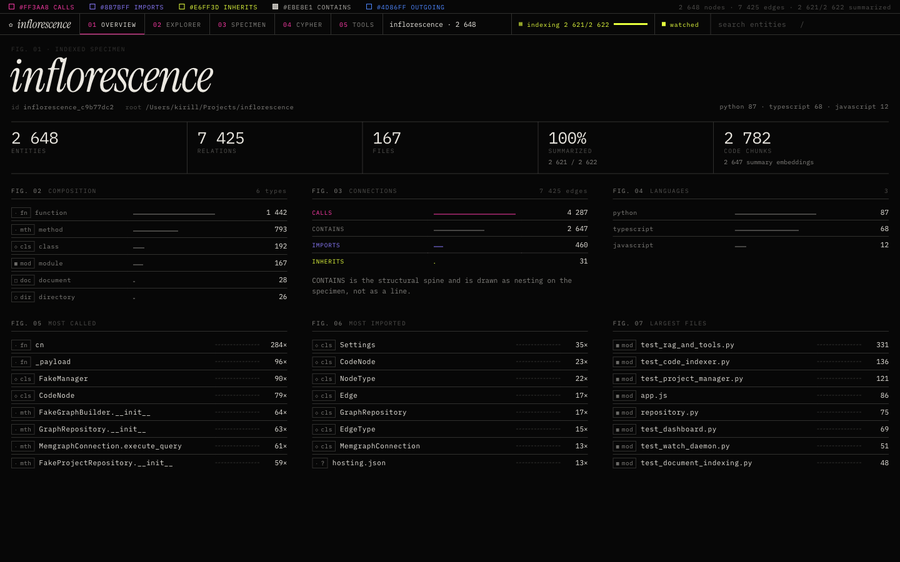
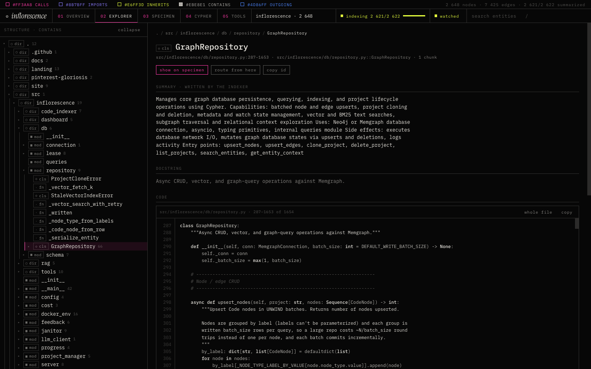
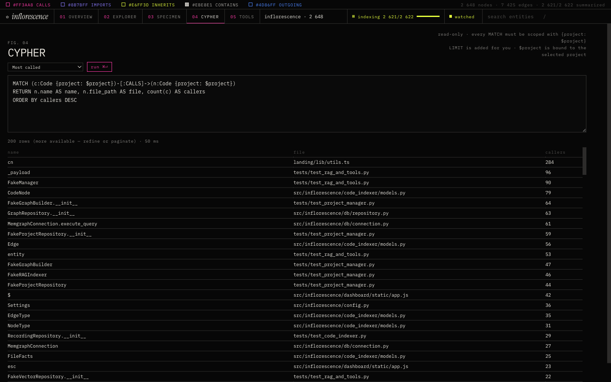
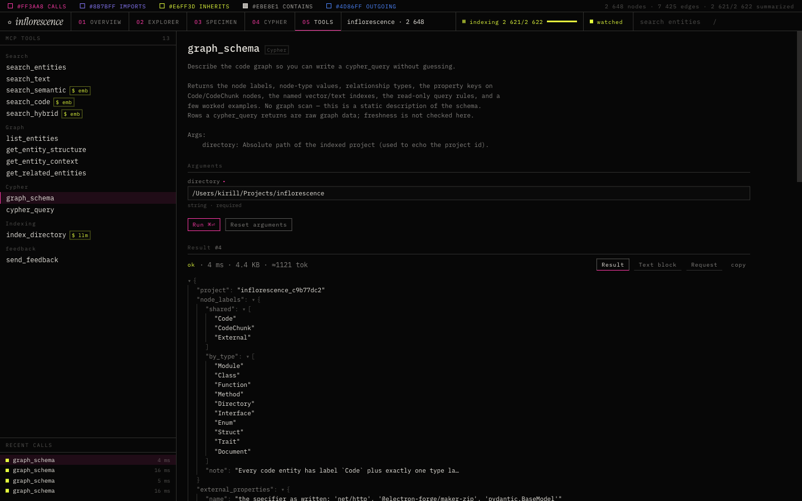

<picture>
  <source media="(prefers-color-scheme: dark)" srcset="assets/specimen.svg">
  
</picture>

# *inflorescence*

MCP server. Your repository as a graph: parsed, summarized, embedded, kept live.

The plate above is not an illustration. It is this repository as the server holds it, rendered
from the export of its own index. Every ring is a `CONTAINS` edge, every curve is a `CALLS`,
`IMPORTS` or `INHERITS` edge bundled through the discs it crosses, and every number printed on
it is counted from the export.

| | edge | what it records |
|---|---|---|
| `#FF3AA8` | `CALLS` | a call site, resolved to the entity it reaches; carries `resolution` |
| `#8B7BFF` | `IMPORTS` | a module pulling in another module, a document, or an `External` package |
| `#E6FF3D` | `INHERITS` / `IMPLEMENTS` | a base class or interface, inside the project or `External` |
| `#EBE8E1` | `CONTAINS` | the containment spine: directory → module → class → method |
| `#000000` | `HAS_CHUNK` | an entity to the overlapping windows of its own text |

Those five are the whole vocabulary of the graph, and the whole palette of this document.

---

## FIG. 01 · PARSE

One pass over the tree, in this order. Nothing later in the list runs if something earlier
refuses.

1. **Scan.** Walk the root, honoring `.gitignore` (unless `RESPECT_GITIGNORE=false`),
   `.inflorescenceignore` (always), `EXCLUDE_PATTERNS`, `MAX_FILE_SIZE_BYTES`, and
   `SKIP_GENERATED`. Dependency lock files and linked git worktrees are dropped
   unconditionally, before includes are even consulted.
2. **Parse.** Python through the stdlib `ast` (with an LLM extractor as fallback for a file
   that fails to parse); JavaScript, TypeScript, Go and Rust through tree-sitter; every
   configured non-code extension through the document parser, which emits one node per file
   and extracts no structure.
3. **Resolve.** Cross-file `CALLS`, `IMPORTS`, `INHERITS`, `IMPLEMENTS`. See `RESOLUTION`
   below for the ladder and for what happens to a call site that no rung can place.
4. **Gate.** Price the run and compare it against the cap. See `FIG. 06 · COST`.
5. **Summarize.** Bottom-up: leaf, then module, then directory. A node whose
   `summary_input_hash` matches what the database already holds is reused, not re-sent.
6. **Embed.** Code chunks (`CHUNK_SIZE` / `CHUNK_OVERLAP`, AST-aware) and summaries, into two
   separate vector spaces.
7. **Write.** Batched `UNWIND` into Memgraph, `DB_WRITE_BATCH_SIZE` rows at a time.

Indexing persists incrementally: entities are name-searchable right after parsing, summaries
stream in batch by batch, and an interrupted run resumes without repeating LLM spend.

---

## FIG. 02 · GRAPH

Twelve node types and five edge types, plus the chunks.

```
directory ──CONTAINS───▶ directory · module · document
module    ──CONTAINS───▶ class · function · variable · type_alias
class     ──CONTAINS───▶ method

module    ──IMPORTS────▶ module · document · External
class     ──INHERITS───▶ class · External
class     ──IMPLEMENTS─▶ interface · External
function  ──CALLS──────▶ function · method
Code      ──HAS_CHUNK──▶ CodeChunk
```

| | values |
|---|---|
| `node_types` | `module` `class` `function` `method` `directory` `interface` `enum` `struct` `trait` `document` `variable` `type_alias` |
| relationship types | `CONTAINS` `CALLS` `IMPORTS` `INHERITS` `IMPLEMENTS` `HAS_CHUNK` |
| node labels | `Code` + exactly one type label (`Module`, `Class`, …, `TypeAlias`); `CodeChunk`; `External` |
| `CALLS.resolution` | `semantic` `exact` `import` `field-type` `self` `same-module` `same-package` |

Every entity carries `id`, `name`, `file_path`, `line_start` / `line_end`, `signature`,
`docstring`, `summary`, `summary_input_hash`, `summary_prompt_version`, `parent_id`, `checksum`,
`calls_provenance`, `external_calls`, `unresolved_calls`, and its summary embedding. `graph_schema` returns this
list at run time, which is what you should read before writing Cypher.

**`document` nodes** are non-code files indexed whole — prose, stylesheets, markup and
configuration. They are leaves: a heading is not a symbol, nothing calls a paragraph, and a CSS
rule is not a function, so no structure is invented above them. Their body reaches search as
overlapping windows (`DOCUMENT_CHUNK_SIZE` / `DOCUMENT_CHUNK_OVERLAP`), which is what makes a
`@media (prefers-reduced-motion)` block in the middle of a stylesheet findable at all. They own
no outgoing edges, but code that imports one by path — `import './index.css'`,
`import cfg from './config.json'` — points an `IMPORTS` edge at it, so "who pulls in this
stylesheet" is an ordinary `get_related_entities(direction="incoming")` call. Filter them in or
out with `node_types=["document"]` like any other type.

**Declarations — `variable` and `type_alias`** are top-level bindings that are not functions
(`export const RULES = [...]`, `MIN_BATCH_SIZE = 400`, a Go `var`, a Rust `static`) and named
types that are not classes (`type OrderTotals = {...}`, `type Status string`). Their signature is
the declaration's first line, and that is their whole description: they get no LLM summary and
take no part in their module's summary input, so their appearance re-buys no summary anywhere.
Find them by name (`search_entities`) and their lines with `search_text` / `find_text`; their
text stays inside the module's chunks.

**`External` nodes** are packages the project imports and base classes it inherits from,
living outside the indexed tree. They are deliberately *not* labelled `Code`, so they never
appear in entity listings, counts, search or summaries — but they make the dependency graph
traversable:

```cypher
MATCH (:Code {project: $project})-[:IMPORTS]->(e:External {project: $project})
RETURN e.root AS dependency, count(*) AS uses ORDER BY uses DESC
```

---

## FIG. 03 · SUMMARY

Every entity gets one LLM-written summary, and it is what `search_semantic` searches. A
container's summary is written from its children's summaries, so the hierarchy reads
bottom-up: method → class → module → directory.

Written bottom-up, read top-down. Because each directory's summary describes its whole subtree,
an agent that does not know where something lives can walk down to it one level per call —
`get_entity_structure(dir)` for the root, `file_path="src/pkg"` for a directory,
`file_path="src/pkg/client.py"` for a file's functions with line ranges — reading a short page of
summaries at each step instead of listing every module at once. Or jump by meaning:
`search_semantic(node_types=["directory"])` ranks directories against directories only (they
and modules have vector indexes of their own, so a few dozen directories are not crowded out of
the candidate pool by every function of every indexed project). A database created before those
indexes existed gets them at the server's next start; until then the search uses the shared index
and says so in `meta.summary_index_fallback`.

Re-summarization is decided by a content hash, not by a timestamp. `summary_input_hash` is
`H(source + signature + docstring)` for a leaf and `H(ordered child descriptors, each carrying
that child's current summary)` for a container. A changed leaf therefore propagates exactly one
path upward — the file, its directory, the root — and nothing else in the project is re-sent.

On failure the previous summary is kept and the hash is cleared, so the node is dirty again
next run: stale beats empty (INV-3).

Each summary also records which prompts wrote it: `summary_prompt_version` (`"<layout>.<digest
of the system prompts>"`). It is deliberately *not* part of the hash — a reworded prompt does
not re-buy every summary in every indexed project. A reused summary keeps the version it was
written with, so one project can hold several revisions —
`MATCH (n:Code {project: $project}) RETURN n.summary_prompt_version, count(*)` shows which (empty
= written before versions were recorded). Rebuilding older ones is a deliberate, priced decision. `USE_LLM_SUMMARIES=false` skips this stage entirely and
builds a graph with code-chunk embeddings and no summaries.

---

## FIG. 04 · SEARCH

Five ranked ways in, plus one exhaustive one. The ranked five differ in what is embedded, not in
how the results are shaped.

| tool | searches | reach for it when |
|---|---|---|
| `search_semantic` | summary vectors | you know what the code *does*, not what it is called |
| `search_code` | code-chunk vectors | you half-remember the shape of the code itself |
| `search_hybrid` | both, deduplicated per entity | you do not want to choose |
| `search_text` | BM25 over names, signatures, summaries, raw code | an identifier, a string literal, an error message, non-English text |
| `search_entities` | entity names, case-insensitive substring | you know part of the identifier — and it answers the moment parsing finishes, before any summary exists |
| `find_text` | every line of every indexed file, literal or regex, unranked | the answer must be *complete*: every use before a rename, a CSS token, a config key — each line tied to the innermost entity holding it |

All five take `node_types`, `include_paths` / `exclude_paths` globs, `include_tests`,
`min_score`, `limit` and `offset`; `find_text` takes the path filters, `include_tests`, `regex`
and `case_sensitive`. Summaries and the identifiers they are matched against are
English-dominated, so a query in another language embeds far from that space and returns a
plausible-looking wrong answer rather than an error — put non-English text and exact strings
through `search_text`.

**An empty result says which kind of empty it is.** This is INV-7, and it is the reason to
trust a page that carries nothing:

- Not indexed → `project_not_indexed`, with the sentence *"This is different from an indexed
  project that simply has no matches."*
- A typo'd argument → `invalid_node_type` / `invalid_direction`, checked before the database is
  touched, never an empty page.
- The scan stopped at an internal ceiling → `page.truncated: true`, so a short page there is not
  evidence that nothing matches.
- The hits were far away → `"weak": true` on each hit below `SEMANTIC_WEAK_THRESHOLD` (0.5 by
  default), and `meta.weak_results: true` when *every* hit on the page was weak. That is the
  closest a vector search can honestly get to "this code is not here". `search_text` never sets
  it: BM25 scores are unbounded relevance, not similarities.
- An empty page gets neither flag, because no hits is not the same claim as "the hits were far
  away".
- The file was never indexed at all → `meta.index_coverage` on every empty first page. This is
  the gap the others could not see: staleness is defined against a node, so a file that never
  entered the index has nothing to flag, and an empty page came back with `"checked": 0`, empty
  `stale`/`missing` lists and a watcher line promising a daemon was following the tree. The
  block re-checks the directories this index knows against the filesystem and either names
  files that are on disk and absent from the index, or states that nothing under that scope is
  missing — which is what makes "it does not exist" a safe conclusion instead of a guess. It is
  bounded on purpose (only known directories, capped in count and wall-clock) and says so when
  it stops early. `get_entity_structure(file_path=…)` answers the same question directly: a
  path that exists on disk but was never indexed reads differently from one that does not exist.

Every response carrying entities also names its provenance: `meta.answered_from` (path,
`branch @ short commit`, and for a worktree the checkout it belongs to), and
`meta.index_freshness`, which re-hashes that page's files and flags an item whose file changed
after indexing (`"stale": true`) or is gone from disk (`"file_missing": true`). An unflagged
item was checked and still matches. When the files on a page live in an independent checkout
inside that tree — a submodule, a vendored repository on its own branch — `meta.nested_checkouts`
names it and its HEAD, because that, not the outer branch in `answered_from`, is the code being
read.

**A search is a few calls, not one.** Every search page carries `meta.facets` — where the
candidates came from, not just the page (for a ranked search, the best 100 entities the page is
cut from, so `counted` is that pool's size, not a total): `counted`, the `common_path` they share, `by_directory`
(one level below it, largest first), `by_node_type`, and — unless `include_tests=false` —
`tests`. There are no ranking tricks and
no advice strings: when one tree dominates (fixtures, a vendored copy, generated code, tests),
the next call narrows with `exclude_paths=["that/tree/"]` or `include_paths=["src/"]`, and the
facets show what is left. `find_text`'s facets are exact counts over every match. Search hits
from test-like paths carry `"is_test": true`, and `include_tests=false` is a shortcut for
excluding the test-path heuristic — a test summary restates the vocabulary of the code it
exercises, so tests out-rank that code on the very queries used to find it.

---

## FIG. 05 · WATCH

An index is a snapshot. Nothing about indexing keeps it matching the code.

Indexing through the MCP server leaves a file watcher inside *that server process* — a child of
one editor session, which dies when the session does. It is real while it lasts and worthless
afterwards: close the window and the index stops moving while every tool keeps answering in the
present tense. `meta.index_freshness.watcher` says which of the two you have.

The daemon is the process that is supposed to be running:

```bash
inflorescence watch add /path/to/repo    # register an already-indexed project
inflorescence watch install              # macOS: launchd job, runs at login, starts now
inflorescence watch status               # who is registered, and what is actually followed
inflorescence watch status --stale       # ...and how far each project has drifted from disk
inflorescence watch run                  # foreground instead (this is what launchd runs)
inflorescence watch rm /path/to/repo     # stop following; the index itself is left alone
inflorescence watch uninstall            # remove the launchd job; indexes untouched
```

`watch status` leads with the machine-level fact — a daemon either runs here or it does not —
then separates the three per-project states, because only one of them means the index can be
trusted an hour from now:

```
Daemon: running on this machine (my-laptop.local:76027:efdf2ae…)

WATCHED /Users/me/code/shop  [current]
        shop_3c1f07aa — daemon my-laptop.local:76027:efdf2ae…
IDLE    /Users/me/code/api  [867 file(s) to reindex, ~$7.97 to catch up]
        api_1c0ffee0 — registered, no daemon running
OFF     /Users/me/code/scratch
        scratch_deadbeef — not registered
```

`IDLE` is the state after a reboot: the registry still says the project is followed and nothing
is following it. `--stale` adds the bracketed figures — how many files an incremental re-index
would touch and what the catch-up would cost — by re-hashing every indexed file, which is
seconds per thousand files.

Four decisions worth knowing:

- **Registration is explicit.** Indexing a tree does not enlist it. A machine accumulates
  worktrees for branches abandoned weeks ago, and following those spends money summarizing
  commits nobody will read. The registry is a `watched` flag on the project root node, not a
  file.
- **Adoption reconciles first.** A watcher only ever hears about edits made while it runs, so
  the daemon runs one ordinary incremental re-index when it picks a project up. That catch-up
  is priced and gated by `MAX_INDEX_COST_USD` exactly like a manual re-index; a refusal leaves
  the daemon watching, and `WATCH_CATCH_UP=false` turns it off for zero unattended spend.
- **One daemon per machine.** A second `watch run` refuses at the door and names the process
  that already holds the job. The claim is keyed by hostname, so a shared Memgraph still lets
  another machine run its own.
- **One claim per project under that.** Each followed project is claimed by a lease with a
  heartbeat, so nothing re-indexes a save twice and a `SIGKILL`ed daemon releases its projects
  in a couple of minutes rather than wedging them forever. The launchd job restarts only
  *failed* runs, which is what makes that case self-heal, while a deliberate stop stays stopped.

`watch install` pins the directory you install from into the job and refuses to install if no
API key is visible from there. Both guard the same trap: settings come from a project-local
`.env` as well as the per-user one, and a launchd job starts in `/`, where a checkout's `.env`
does not exist. Install from the directory whose `.env` holds your key, or run
`inflorescence init` to write the per-user file and install from anywhere.

On save, the watcher debounces (`WATCHER_DEBOUNCE_SECONDS`, default 5s), then reconciles: new
functions appear, deleted ones are removed, changed signatures update, cross-file edges are
re-resolved. Run with `--debug` to watch it:

```
Observed modified event for project=…: src/app/service.py (1 path(s) pending flush)
Flushing 1 changed file(s) for project=…
Applying watcher update for project=…: 1 changed path(s) under /path/to/repo
Detected 1 changed and 0 deleted file(s); rebuilding project
Summarization complete: 10 nodes, 5 regenerated, 5 reused
```

The whole project is re-parsed and re-resolved — a one-line edit can change what another file
is recorded as calling — but a chunk or summary vector the database already holds is left
exactly where it is instead of being re-stored with an identical value. The `chunks` and
`summaries` an update reports are therefore what it **wrote**; `db` in the same result carries
the totals.

---

## FIG. 06 · COST

Indexing costs real money. Two mechanisms keep that deliberate (INV-10).

**Preview.** `index_directory(path, preview=true)` and `inflorescence index <path> --dry-run`
both count files, bytes, entities and tokens and price them — no database writes, no LLM calls,
no watcher started. `largest_files` names the biggest files priced, each with its own share of
the quote, so a generated table or a fixture tree that dominates it is visible before you pay —
add it to `.inflorescenceignore` and preview again. Read the estimate, then run for real.

```bash
inflorescence index /path/to/repo --dry-run          # estimate volume + cost
inflorescence index /path/to/repo                    # build
inflorescence index /path/to/repo --max-cost 2.50    # refuse above this estimate
inflorescence index /path/to/repo --force            # re-parse and re-resolve unchanged files
```

**Cap.** `MAX_INDEX_COST_USD` (default `10.0`, empty to disable) gates *every* run that would
spend: a first index, a re-index, each watcher flush, and the daemon's catch-up. The per-call
`max_cost_usd` argument overrides it for that run. An estimate above the cap is refused before
any money is spent, and the refusal reports the estimate so you can raise the cap deliberately.

A first index is priced over the whole tree; a re-index and a watcher update are priced over
only the files whose content moved. So a routine refresh of a large repository is never rejected
for work it is going to reuse — while an upgrade that widens what the indexer admits (one new
`DOCUMENT_EXTENSIONS` entry can make thousands of files newly billable) still has to clear the
cap before it spends. The estimate uses `LLM_PRICE_INPUT_USD_PER_MTOK`,
`LLM_PRICE_OUTPUT_USD_PER_MTOK` and `EMBEDDING_PRICE_USD_PER_MTOK`, whose defaults match the
default models: switch models and update the prices, or the cap measures the wrong thing.
An upgrade that changes how files are cut into chunks (`CHUNK_FORMAT`) re-chunks unchanged
files on their next run too; that re-embedding is priced with the run, never spent unannounced.

`--force` re-parses and re-resolves even when no file changed — needed after an upgrade that
improves parsing or edge resolution, since the incremental path compares content checksums and a
better indexer would otherwise reach an unchanged file only when some run re-parses the tree.
Summaries and embeddings are still reused by content hash, so what it pays for is the summaries of
entities the upgrade newly recognizes (or now reads a different signature or docstring for) and
of the containers above them — after the upgrade that added `variable`/`type_alias`, 3–10% of a
project's summaries. It is not a data wipe.

Every update re-parses the whole tree, since one edit can change what another file is recorded as
calling — so after a parser upgrade the *first* update of each project, a watcher flush or the
watch daemon's catch-up, summarizes the same newly recognized entities. Its cost gate prices the
changed files and the re-chunking, not those summaries yet: after upgrading, run `--force`
deliberately rather than leaving that bill to the next background update.

### Narrowing a scope: `prune`

`--exclude` keeps a path out of a *scan*; it does not remove what an earlier, wider scan already
stored. That asymmetry is deliberate — an excluded file is still on disk, so a re-index cannot
tell "the operator narrowed the scope" from "the scan lost these files", and a refresh that
guesses wrong deletes paid work (INV-1/INV-3). Dropping what a narrowed scope no longer covers
is therefore its own command:

```bash
inflorescence prune /path/to/repo --exclude tests/golden --dry-run   # what would go
inflorescence prune /path/to/repo --exclude tests/golden             # drop it
```

It costs nothing — no scan, no parse, no LLM, no embedding — and deletes the nodes and chunks of
every indexed file the pattern refuses, plus directory nodes left holding nothing. The patterns
are merged into the project's stored scan scope, so the watcher stops re-admitting those paths.
`--include` replaces the stored include scope instead, pruning anything it does not cover.

### Keeping a tree out for good: `.inflorescenceignore`

`--exclude` lasts for the call that passes it. To settle the question once, commit a
`.inflorescenceignore` — gitignore syntax, honored in any directory under the root, merged with
a same-directory `.gitignore`, and honored whatever `RESPECT_GITIGNORE` says, because its whole
point is a path you want in git and out of the index:

```gitignore
# shop/.inflorescenceignore
worker/tests/golden/
worker/analysis/sites/
```

Every scan reads it — an explicit index, a watcher update, an agent calling `index_directory`
with no arguments — so no caller has to remember a flag, and the rule travels with the
repository instead of living in one machine's database. The three answer a fixture tree
together: `.inflorescenceignore` to keep it out from now on, `--exclude` for a one-off run,
`prune` once to drop what the earlier, wider run already stored.

---

## FIG. 07 · INSTALL

```bash
uv tool install git+https://github.com/uiqkos/inflorescence
inflorescence init
```

That is the whole installation. `init` walks through everything the server needs, in order:

- asks for an [OpenRouter](https://openrouter.ai/) API key and writes it to
  `~/.config/inflorescence/.env` (`%APPDATA%\inflorescence\.env` on Windows). The key must have
  **credit on it**: `doctor` checks that a key is present, not that it has balance, and an
  exhausted key passes the check and then fails every call;
- makes sure Docker works — launches Docker Desktop / OrbStack if installed but not running,
  and on a macOS without Docker offers to install it via Homebrew;
- pulls the **`memgraph-mage`** image (first run only, >1 GB — the vector indexes semantic
  search needs do not exist on a plain Memgraph build) and starts the `inflorescence-memgraph`
  container;
- registers the MCP server with Claude Code, or prints the JSON block for any other client;
- finishes by running `inflorescence doctor`.

The only prerequisite installed by hand is [uv](https://docs.astral.sh/uv/) itself, plus Docker
Desktop or [OrbStack](https://orbstack.dev/) if you are not on macOS with Homebrew.
`uv tool install inflorescence` (PyPI) will follow from the first tagged release. Python 3.11+.

On a fresh install `doctor` reports one failure — the schema is created by the first index, so
it cannot exist yet:

```
[PASS] Config loads: pydantic Settings constructed
[PASS] OPENROUTER_API_KEY: present
[PASS] Memgraph reachable: bolt://localhost:7687
[PASS] Watch daemon: no projects registered (0 indexed)
[FAIL] Schema present: not found
       hint: Run `inflorescence index <path>` to create the schema
[PASS] SCIP indexers: go=docker, python=docker, typescript=docker

Doctor: problems found
```

Index something and that line goes green. From then on your assistant can call
`index_directory` itself. The `SCIP` rows appear only while `USE_SCIP_SEMANTIC` is on, and
never fail the run — they report which rung each language would use, and which container image
would execute, before you spend anything.

### Running the server by hand

```bash
inflorescence serve                # stdio; this is also what a bare `inflorescence` does
inflorescence --debug serve        # verbose logs (handler events, update lifecycle)
inflorescence serve --allow-degraded   # start even if Memgraph is unreachable
```

### MCP client configuration

`init` detects Claude Code and runs `claude mcp add` for you, or prints a ready-to-paste Claude
Desktop snippet otherwise. `uv tool install` places the `inflorescence` script in uv's tool-bin
directory, which may not be on your client's `PATH` — use the absolute path (`which
inflorescence`):

```json
{
  "mcpServers": {
    "inflorescence": {
      "command": "/absolute/path/to/inflorescence",
      "args": ["serve"],
      "env": { "OPENROUTER_API_KEY": "your_key_here" }
    }
  }
}
```

The `env` block is belt-and-braces. The key lives in `~/.config/inflorescence/.env`, so the
server finds it whatever working directory the client launches it from; keep the block only if
you want a different key for this one client.

<details>
<summary>From a checkout instead (development)</summary>

```bash
git clone https://github.com/uiqkos/inflorescence
cd inflorescence
uv sync

docker compose up -d              # optional: Memgraph + Lab on http://localhost:3000
uv run inflorescence init         # stores the key, starts Memgraph, registers the server
uv run inflorescence doctor
```
</details>

<details>
<summary>Where the key is stored, and how Memgraph gets started</summary>

`init` writes the key to **`~/.config/inflorescence/.env`**, not to a `.env` beside the
directory you ran it from. An MCP client launches the server with its own working directory, so
a project-local key is invisible to the very process that needs it — that produced a server
which started cleanly and then failed every LLM call. A project `.env` still works and takes
precedence when present; real environment variables outrank both.

Memgraph is started for you. Inside a checkout of this repository `init` uses `docker compose`
(which also brings up Lab); anywhere else it starts a standalone container. Either way it is
**one container, `inflorescence-memgraph`** — compose pins that name rather than taking its own
— published on loopback only, with its data in a named volume so the graph survives
`docker rm`. `serve` does the same on startup, since an MCP client offers no moment at which
you could have started the database yourself. When Docker is installed but not running (the
default state of a fresh laptop), the Docker Desktop or OrbStack app is launched and the daemon
awaited; the `memgraph-mage` image is pulled as its own patient step on first run, so a
multi-minute download never masquerades as "could not start Memgraph".

The single name is load-bearing. Two containers over one database volume do not give you a
spare: they fight for port 7687, and the loser can end up *running* yet attached to no network
— publishing nothing, refusing every connection mid-handshake, and unfixable by restarting it.
`doctor` reports a second container as soon as it exists, while the database still answers.

So the two paths defend against each other. `init` and `serve` adopt whatever container already
holds the volume instead of adding one. Compose, which cannot adopt a container it did not
create, fails loudly on the pinned name — `Conflict. The container name
"/inflorescence-memgraph" is already in use` means the database is already up and compose has
nothing to do (`docker start inflorescence-memgraph` is the whole job; use compose only if you
also want Lab, and then start from `docker compose down`).

If you meet a spare anyway, stop it (`docker stop -t 600 <name>`); to repair a container already
orphaned off the network, recreate it — the graph is in the volume, not the container:

```bash
docker stop -t 600 inflorescence-memgraph
docker rm inflorescence-memgraph
docker run -d --name inflorescence-memgraph \
  --restart unless-stopped --stop-timeout 600 -p 127.0.0.1:7687:7687 \
  -v inflorescence_mg_data:/var/lib/memgraph \
  memgraph/memgraph-mage:latest \
  --storage-snapshot-on-exit=true --storage-snapshot-interval-sec=21600 \
  --storage-snapshot-retention-count=2
```

Give it a couple of minutes on a populated graph: `memgraph-mage` loads its query modules and
replays the last snapshot before it opens bolt (~100s on a 187k-node graph), so a database that
is merely starting looks exactly like one that is down. `docker logs -f inflorescence-memgraph`
shows which it is.
</details>

**Stopping and memory.** Disabling MCP in one client does not stop the shared database or
servers owned by other sessions. Each stdio session has its own Python process; Memgraph
keeps the graph and vector indexes in RAM even without queries. To leave it off:

1. Set `MEMGRAPH_AUTOSTART=false` in your per-user or checkout `.env`. New `serve` and
   `watch` commands then leave Docker and a stopped local database alone. With the database
   down, `serve` exits before loading its MCP/indexing stack (unless `--allow-degraded`).
2. Disconnect Inflorescence in all MCP clients and close their existing server processes.
   If installed, stop its independent watch daemon with `inflorescence watch uninstall`.
3. Run `docker stop -t 600 inflorescence-memgraph` (and stop Lab if it is running).
   The named volume and indexes are retained. The long grace period lets Memgraph finish
   its exit snapshot; Docker's default 10 seconds can leave a truncated multi-GB snapshot.

Resume with `docker start inflorescence-memgraph`, then reconnect the MCP clients. Set
`MEMGRAPH_AUTOSTART=true` again if you want client sessions to start the database for you.
Compose and newly created containers use a 600-second stop timeout; for an existing
container, keep passing `-t 600` until it is recreated with the new configuration.

---

## FIG. 08 · TOOLS

Fourteen tools. The catalogue card, one line each; the server publishes each tool's full
docstring as its description, so this is the index, not the text.

**Index**

| tool | |
|---|---|
| `index_directory` | Index or re-index a directory: parse, build the graph, summarize, embed. `preview=true` prices it first; the result's `watching` says what will keep it current afterwards |

**Graph**

| tool | |
|---|---|
| `list_entities` | Inventory in path order, unranked, with pagination and glob path filters — "what is in this package" |
| `get_entity_structure` | The `CONTAINS` outline under the project root, a directory, a file or a node, one to three levels deep — the top-down walk: root → directory → file → functions, a subtree summary at every step |
| `get_entity_context` | One call, one known `node_id`: full summary plus parent, children, incoming and outgoing edges |
| `get_related_entities` | Entities related by relationship and `direction` (`both` / `incoming` / `outgoing`), addressed by `node_id` **or** by a `name` substring the tool resolves itself — so "who calls X" is one call. An ambiguous name returns the candidates instead of guessing |
| `search_entities` | Case-insensitive substring of an entity's name; answers before any summary exists |

**Search**

| tool | |
|---|---|
| `search_code` | Vector similarity over raw code chunks |
| `search_semantic` | Vector search by meaning over summaries |
| `search_hybrid` | Both, deduplicated per entity |
| `search_text` | Exact BM25 over names, signatures, summaries and raw code |
| `find_text` | Exhaustive line search, literal or regex, over every indexed file plus new ones on disk — each line with its owning entity, exact `meta.facets` |

**Query**

| tool | |
|---|---|
| `cypher_query` | Paginated read-only Cypher. Writes, `CALL`, `LOAD`, admin clauses and `LIMIT`/`SKIP` are rejected; every `MATCH` must be project-scoped |
| `graph_schema` | Labels, node types, relationship types, property keys, named indexes, query rules and worked examples — no graph scan |

**Feedback**

| tool | |
|---|---|
| `send_feedback` | The agent's channel back to the maintainer: which description sent it to the wrong tool, which result was empty when the code plainly exists, what took four calls |

Limits are clamped, not errors: `limit` is capped at 500 for graph tools, `cypher_query` and
`find_text`, 100 for the four searches; navigation summaries are truncated to 200 characters
(`full_summaries=true` returns them whole on pages of at most 25, or use `get_entity_context`); a search hit carries at most three `matches`, with
`matches_total` present only when the list was trimmed.

---

## DASHBOARD

```bash
inflorescence dashboard                       # http://127.0.0.1:8321
inflorescence dashboard --port 9000 --no-browser --host 127.0.0.1
```

Five views, switchable per project, served by a local Starlette app over the same
`GraphRepository` the MCP tools use.

- **Overview** (`/api/projects/{project}/stats`) — entity and relation counts, type
  breakdowns, summary coverage, most-called and most-imported entities, largest files.
- **Explorer** (`/tree`, `/entity`, `/code`) — the containment tree with hierarchical
  summaries; per-entity pages with summary, signature, docstring, source and clickable
  relations.
- **Graph** (`/specimen`) — the specimen: the whole project as nested `CONTAINS` discs, the
  same layout as the plate at the top of this file, laid out client-side from one compact
  payload. Scope it to a path prefix, drop to files only, keep only entities that already carry
  a summary (so the specimen grows batch by batch while an index runs), fit the frame, or ask
  for the shortest route between two entities over the real edges. `/graph` still serves the
  neighbourhood of one entity, filterable by relation type, but the view no longer uses it.
- **Query** (`/query`, POST) — the read-only Cypher console with presets; node-bearing rows can
  be numbered onto the specimen, so a query's answer is shown on the real graph rather than as a
  separate picture.
- **Tools** (`/api/tools`, `/api/tools/call`, `/api/tools/runs/…`) — the MCP surface, callable
  by hand. Every tool the server hands an agent is listed with its real description; picking one
  builds a form from its JSON schema (required fields marked, defaults shown, `directory`
  pre-filled). The panel then shows what the agent gets: parsed payload, raw text block byte for
  byte, the argument object that was sent, plus duration, payload size and an approximate token
  count. Entity ids in a result link into the Explorer, and recent calls can be re-run with one
  value changed.

The specimen is one canvas: drag to pan, wheel to zoom toward the cursor, click a node to pin
it, double-click a disc to frame it, `F` to fit, `Esc` to peel back one layer (panel, then
replay, then the pin). Hovering traces the question an agent asks the server — who calls this
(pink, incoming) and what it calls (blue, outgoing); the pinned card carries the entity's name,
type, `path:lines`, summary and degrees, with links into the Explorer, the route tool and a path
scope. Selecting an entity anywhere — the tree, a search result, a Cypher row — aims the
specimen at it, and a search's hits land on the graph numbered, a weak match drawn weakly.

**route** takes two entities, picked on the canvas or typed by name, and draws the shortest path
between them over the real edges (a `CALLS`, `IMPORTS` or `INHERITS` edge costs 1, a step up or
down `CONTAINS` costs 2.4), listed as `create_server ─CALLS→ create_components ─CALLS→
GraphRepository` in the colours of the edges it used. If nothing connects them, it says so.

**gfx** switches the display and nothing else: labels, edge ink, the idle pulse, the load bloom,
the row-tearing glitch, the scanlines, and the paper variant — the same specimen as ink on a
herbarium sheet. The dirt is live rather than baked, on by default, off in one click. **replay**
re-runs the bloom (pause, 0.5–4×), **rec** captures the canvas to a video file, **png** saves a
still. The graph view ships no vendored JavaScript: layout, bundling, camera and routing are
`static/pack.js`, derived from the landing page's specimen engine. On a 17 623-entity,
24 234-edge index the layout takes 0.7 s and a drawn frame about 1.4 ms — and a specimen left
open costs almost nothing, because the canvas repaints only when something actually changed:
the camera, a hover, a pin, a filter, entities landing from a live index. Sitting still, on
another view, or in a background tab, it draws nothing at all.

The header carries two badges answering different questions. The pulsing **indexing** badge
means a run is happening right now. The **watch** badge beside it is about the rest of the time:
`watched` when a daemon follows this tree, `watch idle` when the project is registered but
nothing is running it, `unwatched` when nothing keeps it current at all. Clicking it runs a
drift check against disk (`/freshness`) — a real scan, too slow to poll, so it is asked for —
and reports `up to date` or `N file(s) behind ≈$X`.

Tool calls run in the background on their own event loop: a long `index_directory` survives a
page reload, keeps the rest of the dashboard responsive, and can be cancelled (cancellation
lands at the tool's next await, so a blocking filesystem scan may still finish). The two
money-spending paths are explicit — tools that call an embedding or LLM API are labelled, and
`index_directory` with `preview=false` is refused by the API unless the confirmation checkbox
was ticked. Indexing from here deliberately starts no file watcher: the MCP server owns that.







---

## WORKTREES

A linked git worktree is a different tree, so it is its own project — but the main checkout's
index is a free cache donor, and none of this needs a flag.

- **First read query indexes it inline.** A worktree of an *indexed* checkout is the one case
  where a tool indexes instead of refusing: the query that triggered it waits for the finished
  index, so the answer is never built on a half-index. Parallel first queries are serialized to
  one build by an asyncio lock plus a cross-process lease.
- **The donor's graph is copied inside Memgraph.** `WORKTREE_CLONE` (default on) copies the
  donor's nodes, summaries and chunk vectors server-side, so nothing crosses the wire. Any
  clone failure is non-fatal: the partial clone is deleted and the client-side path runs
  instead.
- **Only the differing files are re-indexed.** After the clone, the checksums that differ from
  the donor are reconciled and the files this branch deleted are dropped. A byte-identical
  worktree has nothing left to index.
- **The preview prices only what the donor does not cover.** `index_directory(preview=true)` on
  such a worktree reports `worktree_of`, `donor_covered_files` and `uncovered_files`, and prices
  only the uncovered ones — pricing the whole tree quoted ~$50 for an index that actually costs
  ~$0, and a preview that scares you away from a free operation is worse than no preview.
- **The result says which path ran.** `worktree_of` names the donor; `cloned` (copied node,
  chunk and edge counts) is present only on the server-side path.
- **A deleted worktree's index is reaped.** Every index of a detected worktree stamps that fact
  on the project root node, which is what lets the janitor drop the index of a worktree git no
  longer knows — and leave every other project alone. `WORKTREE_JANITOR_ENABLED` governs it;
  an ordinary project is never a candidate.

`WORKTREE_AUTO_INDEX=false` disables the whole behaviour. With several worktrees of one
repository on disk, `meta.answered_from` and `meta.index_freshness.live_worktrees` are what tell
you whether an answer describes the branch you are working on — ask a worktree directly by
passing its path as `directory`.

---

## RESOLUTION

`CALLS` edges are resolved by a ladder, and every edge records which rung placed it in its
`resolution` property, so compiler-grade edges are always distinguishable from heuristic ones.

| rung | `resolution` | |
|---|---|---|
| SCIP indexer | `semantic` | compiler-grade, where the project builds |
| syntactic ladder | `exact` `import` `field-type` `self` `same-module` `same-package` | in that order; 100% precision against SCIP ground truth in our measurements |
| unresolved, bound to an import outside the project | — | recorded on the caller as `external_calls` |
| unresolved, nothing to bind to | — | recorded on the caller as `unresolved_calls` |

What cannot be resolved is **recorded, not guessed**. There is deliberately no "globally unique
short name" fallback (it measured 39% precision) and no `candidates[0]` pick, because a wrong
edge is worse than an honest gap: an agent that trusts a fabricated call graph reasons
confidently to the wrong conclusion. A node with zero outgoing `CALLS` and empty
`external_calls` / `unresolved_calls` genuinely calls nothing. Module nodes carry
`calls_provenance` (`scip-go` / `scip-python` / `scip-typescript`, or `heuristic`).

The design, the per-rung precision measurements and the known limits are in
[docs/calls-resolution.md](docs/calls-resolution.md).

**You do not install the SCIP indexers.** If Docker is available the indexer runs in a container
that already carries its toolchain, with the repository mounted **read-only**:

| language | indexer | version | image | by hand instead |
|---|---|---|---|---|
| Go | `scip-go` | 0.2.7 | `inflorescence-scip-go` | `go install github.com/scip-code/scip-go/cmd/scip-go@v0.2.7` |
| Python | `scip-python` | 0.6.6 | `inflorescence-scip-node` | `npm install -g @sourcegraph/scip-python@0.6.6` |
| TypeScript / JavaScript | `scip-typescript` | 0.4.0 | `inflorescence-scip-node` | `npm install -g @sourcegraph/scip-typescript@0.4.0` |

A binary already on `PATH` wins — it is faster, with no container to start. `SCIP_RUNNER` pins
one rung (`auto` by default, or `native`, or `docker`); `SCIP_IMAGES` overrides an image;
`SCIP_TIMEOUT_SECONDS` bounds one run. The two images are split by toolchain, not by language:
`scip-go` drives `go list` and the other two are Node programs, so indexing a Python repository
pulls the Node image and never a Go toolchain.

Containerizing this rung is not only about setup. A SCIP indexer necessarily executes the
**indexed project's own build configuration** — exactly the code you have least reason to trust
when you point this tool at someone else's repository to read it. In the container it sees one
read-only mount and nothing else of your machine.

> Indexing untrusted code? Set `USE_SCIP_SEMANTIC=false`, or leave `SCIP_RUNNER` on its default,
> which confines that toolchain to a container.

A missing indexer, a project that does not build, or a timeout degrades that language to the
syntactic ladder without failing the index. `inflorescence doctor` reports which rung each
language would use before you spend anything.

---

## SUPPLY CHAIN

Three ways to run the SCIP rung. All three are first-class; nothing degrades except as
documented.

**1 · Build the images yourself.**

```bash
inflorescence build-images                          # both
inflorescence build-images --language go --tag v1   # one, --registry to retag
```

The Dockerfiles ship inside the package ([`src/inflorescence/docker/`](src/inflorescence/docker))
with the indexer versions pinned, so a rebuild installs the same tools. The command tags the
result with exactly the references the docker rung looks for, and `docker run` uses a locally
present tag without contacting any registry — after building, no pull ever happens. To be
precise about what "local" means: the *build* still downloads (the base image from Docker Hub,
`scip-go` sources via proxy.golang.org, the two npm indexers from npm), but every ingredient is
named in a recipe you can read instead of arriving as one opaque blob.

**2 · Pull the published images and check who built them.** They are built multi-arch and pushed
by [CI](.github/workflows/images.yml) from a visible commit of this repository — not from
anyone's laptop — and carry GitHub artifact attestations (Sigstore underneath):

```bash
gh attestation verify oci://ghcr.io/uiqkos/inflorescence-scip-go:v1 --owner uiqkos
gh attestation verify oci://ghcr.io/uiqkos/inflorescence-scip-node:v1 --owner uiqkos
```

The code references these images by **immutable digest**, not by tag: a tag can be silently
re-pointed in the registry, a digest cannot. `inflorescence doctor` prints the exact reference
that will run on your machine and whether it is already local.

**3 · Turn the rung off.** `USE_SCIP_SEMANTIC=false`. No containers start at all; `CALLS` edges
come from the syntactic ladder, and everything it cannot resolve is recorded honestly.

Worth stating plainly: the alternative to the container is not "everything stays local" — it is
`go install` / `npm install -g` of the same third-party indexer **with no sandbox at all**, and
an indexer, wherever it runs, executes the build configuration of the repository being indexed.
The container is the contained option: repository mounted read-only, index written to a separate
mount, `--rm`, your uid, and nothing else of the host exposed (`docker_scip_argv` in
[`scip_semantic.py`](src/inflorescence/code_indexer/scip_semantic.py)).

Sizes, measured: scip-go — 243 MB on disk, 76 MB of network transfer; scip-node — 310 MB and
100 MB. Two images rather than one because a merged image would cost ~545 MB and ~170 MB of
transfer for everyone, including a user who only ever indexes Python; only a polyglot repository
would come out ahead, and then by about 6 MB.

---

## FEEDBACK

The agent on the other end of the MCP connection is the only witness to how these tools behave
in a real task. It is the one that read a description and picked the wrong tool, got an empty
page it could not tell apart from "nothing matches", or spent four calls on a question one call
should have answered — and then worked around it inside a session that closed an hour later.
`send_feedback` is where that goes instead. The server asks for it in its own instructions.

```
send_feedback(
  message="search_semantic('retry backoff') returned 5 weak hits, all from tests, while the "
          "implementation is in net/retry.go — search_text on 'backoff' found it immediately.",
  kind="wrong_result",      # bug · wrong_result · missing_capability · confusing_docs
                            # performance · praise · experience_report · other
  severity="high",          # low · medium · high · blocking
  tool="search_semantic",
  directory="/path/to/repo" # records the tree, its branch and its commit
)
```

An unrecognized `kind` or `severity` is filed as `other` / `medium` rather than refused. Read
what came in:

```bash
inflorescence feedback                  # newest 20, oldest first
inflorescence feedback --kind bug       # just the breakage
inflorescence feedback --limit 0 --json # everything, machine-readable
inflorescence feedback --path           # where the file lives
```

```
Feedback log: ~/.config/inflorescence/feedback.jsonl
2 entries

fb_20260908T101500Z_3a0ca9  2026-09-08 10:15:00  wrong_result/high  [search_semantic]
    search_semantic('retry backoff') returned 5 weak hits, all from tests…
    tree:  /path/to/repo (main @ a1b2c3d)
```

Two decisions, both deliberate:

- **It is a plain file, not a node in Memgraph.** The reports worth having most are written when
  the database is unreachable, the project was never indexed, or a tool just raised. A sink that
  shares a failure domain with the thing being reported is empty at the only moment it matters.
  `send_feedback` needs no database, no index, no LLM and no API key.
- **Nothing leaves your machine.** Entries are appended as JSONL to `FEEDBACK_PATH`, never
  uploaded anywhere. There is no telemetry in this project. Whether any of it reaches the
  maintainer is your decision, made by reading the file and forwarding what you choose.

Entries are capped per report (20 000 characters of message, 4 000 per other field) and nothing
ever rewrites or deletes one — the log grows until you prune it yourself.

---

## LANGUAGES

| | |
|---|---|
| Python | stdlib `ast`, with an LLM fallback if a file fails to parse |
| JavaScript / TypeScript | tree-sitter (`.js` `.jsx` `.ts` `.tsx`) |
| Go | tree-sitter (`.go`) |
| Rust | tree-sitter (`.rs`) |
| Prose | `.md` `.markdown` `.mdx` `.rst` `.txt` `.text` `.adoc` `.asciidoc` `.org` — indexed whole, not parsed |
| Styles | `.css` `.scss` `.sass` `.less` `.styl` — indexed whole, not parsed |
| Markup | `.html` `.htm` — indexed whole, not parsed |
| Configuration | `.json` `.jsonc` `.yaml` `.yml` `.toml` `.ini` `.cfg` `.conf` — indexed whole, not parsed |
| Schemas & queries | `.proto` `.sql` `.graphql` `.gql` — indexed whole, not parsed: a gRPC contract or the SQL behind a search is found by its own text and by meaning |
| Shell / operator scripts | `.sh` `.bash` `.zsh` `.fish` `.ps1` — indexed whole, not parsed |
| Build files, by exact name | `Makefile` `GNUmakefile` `Dockerfile` `Containerfile` `Justfile` `Procfile` `Rakefile` `Brewfile` `.env.example` (and `.sample` / `.template` / `.dist`) — indexed whole, not parsed |

Only these extensions and names are scanned; files in other languages are skipped today. The parser layer
is pluggable (`ParserRegistry` maps an extension to a parser), so broader tree-sitter coverage is
a natural next step.

Documents are summarized and embedded like code, so they cost like code: `preview=true` prices
them along with everything else, and adding them to an already-indexed project makes the next
re-index quote more than the last one did. `INDEX_DOCUMENTS=false` leaves them out entirely;
`DOCUMENT_EXTENSIONS` and `DOCUMENT_FILENAMES` narrow the set.

Shell scripts and `Makefile`s are in that list for a reason worth stating: in most repositories
they *are* the runbook. The exact invocation, every flag, and the comment explaining why a flag
is mandatory live in a wrapper script and nowhere else, so a graph holding every Python module
of a `scripts/` directory and none of its nine shell scripts cannot answer "how is this actually
launched". One consequence survives the fix and is worth knowing: a document owns no outgoing
edges, so a module invoked only as `python -m scripts.runner` from a shell wrapper still
has no incoming `CALLS` edge — operator-facing entry points look callerless, and a dead-code
judgement made from incoming edges alone will be wrong about exactly those. A real `.env` is
never indexed; only its committed template is.

Three guards keep generated bulk out. **Lock files** are dropped by name whatever the extension
list says — `package-lock.json`, `npm-shrinkwrap.json`, `yarn.lock`, `pnpm-lock.yaml`,
`bun.lock`, `bun.lockb`, `deno.lock`, `poetry.lock`, `pdm.lock`, `uv.lock`, `Pipfile.lock`,
`Cargo.lock`, `composer.lock`, `Gemfile.lock`, `go.sum`, `mix.lock`, `flake.lock`,
`packages.lock.json`. **Generated output** is skipped while `SKIP_GENERATED` is on: protobuf
output, `*.min.js`, `*.min.css`, bundles, plus any file whose first 2048 bytes carry
`@generated` or `Code generated` … `DO NOT EDIT`. And anything over `MAX_FILE_SIZE_BYTES` is
reported in `skipped_large_files` rather than summarized.

`.xml` is deliberately absent: in practice it is dominated by machine-written trees (IDE
settings, JUnit/coverage reports, generated resources) whose tag soup chunks and embeds badly,
and its hand-written uses belong to toolchains this indexer has no parser for.

---

## CLI

One console script, `inflorescence`. A bare invocation is `serve`.

| command | arguments |
|---|---|
| `serve` | `--allow-degraded` |
| `index <path>` | `--include GLOB` · `--exclude GLOB` (both repeatable) · `--dry-run` · `--max-cost USD` · `--force` |
| `prune <path>` | `--exclude GLOB` · `--include GLOB` (both repeatable) · `--dry-run` |
| `watch add\|rm <path>` | — |
| `watch status [path]` | `--stale` |
| `watch run\|install\|uninstall` | — |
| `feedback` | `--limit N` (0 = all) · `--kind KIND` · `--json` · `--path` |
| `dashboard` | `--host HOST` (default `127.0.0.1`) · `--port N` (default `8321`) · `--no-browser` |
| `init` | — |
| `doctor` | — |
| `build-images` | `--language go\|node\|all` · `--tag v1` · `--registry ghcr.io/uiqkos` |

Global, before the subcommand: `--debug` (overrides `LOG_LEVEL`) and `--log-file PATH`.

---

## CONFIGURATION

Every setting is an environment variable. Two dotenv files are read, in ascending precedence —
`~/.config/inflorescence/.env` (written by `init`; `%APPDATA%\inflorescence\.env` on Windows),
then `./.env` from the process's working directory — and real environment variables outrank
both.

| variable | default | |
|---|---|---|
| `OPENROUTER_API_KEY` | — | OpenRouter API key (**required**) |
| `MEMGRAPH_URL` | `bolt://localhost:7687` | connection URL |
| `MEMGRAPH_AUTOSTART` | `true` | allow MCP/watch commands to start local Docker and Memgraph; `false` respects a manual stop |
| `MEMGRAPH_USER` / `MEMGRAPH_PASSWORD` | — | optional auth |
| `LLM_MODEL` | `google/gemini-2.5-flash-lite` | summaries and the LLM parse fallback |
| `LLM_BASE_URL` | `https://openrouter.ai/api/v1` | OpenAI-compatible endpoint |
| `CODE_EMBEDDING_MODEL` | `openai/text-embedding-3-small` | code-chunk embeddings |
| `SUMMARY_EMBEDDING_MODEL` | `openai/text-embedding-3-small` | summary embeddings |
| `EMBEDDING_DIMENSION` | `1536` | must match both models; changing it requires a re-index |
| `SEMANTIC_WEAK_THRESHOLD` | `0.5` | cosine similarity below which a vector hit is labelled `weak`. A label, not a filter — that is the per-query `min_score` |
| `USE_LLM_SUMMARIES` | `true` | `false` builds a graph-only index that sends nothing to an LLM |
| `INDEX_DOCUMENTS` | `true` | index non-code files as whole documents; `false` leaves them out of the scan |
| `DOCUMENT_EXTENSIONS` | see `LANGUAGES` | which extensions count as a document |
| `DOCUMENT_FILENAMES` | see `LANGUAGES` | exact filenames that count as a document (`Makefile`, `Dockerfile`, `.env.example`, …) |
| `MAX_FILE_SIZE_BYTES` | `262144` | skip files larger than this |
| `MAX_INDEX_COST_USD` | `10.0` | cap on every run that would spend; empty removes it |
| `REQUIRE_SEARCH_INDEXES` | `true` | refuse to index against a Memgraph that cannot host vector indexes, rather than paying for unsearchable embeddings |
| `RESPECT_GITIGNORE` | `true` | `.inflorescenceignore` is honored either way |
| `SKIP_GENERATED` | `true` | skip recognisably generated files |
| `USE_SCIP_SEMANTIC` | `true` | compiler-grade `CALLS` resolution where the project builds |
| `SCIP_RUNNER` | `auto` | `auto` / `native` / `docker` |
| `WORKTREE_AUTO_INDEX` | `true` | index a worktree of an indexed checkout on its first query |
| `WORKTREE_CLONE` | `true` | copy the donor graph inside Memgraph; `false` falls back to the client-side path |
| `WORKTREE_JANITOR_ENABLED` | `true` | reap the indexes of worktrees git no longer knows |
| `WATCHER_DEBOUNCE_SECONDS` | `5.0` | quiet period before a change flush |
| `WATCH_REFRESH_SECONDS` | `30.0` | how often the daemon re-reads its registry (the delay before `watch add` takes effect) |
| `WATCH_CATCH_UP` | `true` | reconcile a project against disk when the daemon picks it up |
| `FEEDBACK_PATH` | `~/.config/inflorescence/feedback.jsonl` | where `send_feedback` appends |
| `LOG_LEVEL` | `INFO` | `--debug` overrides it |

**[`.env.example`](.env.example) is the complete reference** — every setting, with its default
and what it is for. The table above is the subset most people touch. Chunking
(`CHUNK_SIZE` 3000, `CHUNK_OVERLAP` 1000, `DOCUMENT_CHUNK_SIZE` 800, `DOCUMENT_CHUNK_OVERLAP`
200), batching (`BATCH_SIZE` 10, `RAG_INDEX_BATCH_SIZE` 256, `DB_WRITE_BATCH_SIZE` 500), the
price settings and `SUMMARY_MAX_SOURCE_CHARS` (12 000) are documented there.

Logs go to a per-user location — `~/Library/Logs/inflorescence/` on macOS,
`$XDG_STATE_HOME/inflorescence/` on Linux, `%LOCALAPPDATA%\inflorescence\` on Windows — capped
at 10 MB per file with 3 rotations, plus `watch.out.log` / `watch.err.log` for the launchd job.
Override with `--log-file`.

---

## WHAT LEAVES YOUR MACHINE

Indexing sends your source code to third-party APIs. Specifically:

- **To the LLM** (OpenRouter by default): the source of each entity, truncated to
  `SUMMARY_MAX_SOURCE_CHARS` (12 000 characters), for summarization — and the whole file for any
  Python file the AST parser cannot handle, which falls back to an LLM extractor.
- **To the embeddings endpoint**: every code chunk and every generated summary.

Nothing else is transmitted: no paths outside the indexed repository, no telemetry, no
analytics. The graph, the vectors, the dashboard and the feedback log are entirely local.

If that is not acceptable for a given repository, `USE_LLM_SUMMARIES=false` builds the code
graph and skips summarization — but code-chunk embeddings still reach the embeddings endpoint,
so a fully offline index means pointing `CODE_EMBEDDING_BASE_URL` at a local OpenAI-compatible
server.

---

## DEVELOPMENT

```bash
git clone https://github.com/uiqkos/inflorescence
cd inflorescence
uv sync --extra dev
uv run pytest                  # test suite
uv run ruff check src/ tests/  # lint
```

The test suite needs **nothing running** — no Memgraph, no API key, no network. Tests that
require a live database skip themselves unless `INFLORESCENCE_TEST_MEMGRAPH_URL` is set, so a
clean clone gives a green run in seconds. To include them:

```bash
docker compose up -d           # Memgraph + Lab (the same container `init` uses)
INFLORESCENCE_TEST_MEMGRAPH_URL=bolt://localhost:7687 uv run pytest
```

What unit tests cannot check cheaply — that the tools return real payloads against a live stack,
and that editing one file does not re-summarize the project — is a manual gate in
[docs/smoke-test.md](docs/smoke-test.md). CI runs in
[`.github/workflows/ci.yml`](.github/workflows/ci.yml).

---

## DESIGN INVARIANTS

An index is a derivative of your code that costs real money and real time to produce, lives a
long time, and should update cheaply. Ten rules protect that, and every one is the residue of a
production incident rather than an abstraction. Comments in `src/` and `tests/` cite them as
`INV-1` … `INV-10`.

- **INV-1 · Paid-for data is never destroyed.** An update reconciles — upsert what is live,
  delete only what is genuinely stale — instead of wiping and rebuilding, so nothing stored is
  removed before its replacement is written. Updates once began with a project-wide delete, so a
  crashed run left the project with no chunks and no embeddings.
- **INV-2 · Fail closed — no mutation without working dependencies.** If the LLM, an embedding
  endpoint or the database is unreachable, or a key is invalid, a cheap pre-flight aborts before
  the first write instead of discovering it at node 800. A keyless server once "indexed"
  happily, took a 401 on every call, and wrote the results of those failures into the graph.
- **INV-3 · Stale beats empty.** On partial failure the previous value is kept together with a
  marker to recompute next run. A summarization failure once wrote `summary=""` over 876
  perfectly good summaries.
- **INV-4 · One mutation per project at a time.** Concurrent updates are impossible by
  construction (a lock), not by lucky timing. Two watcher flushes racing each other once erased
  each other's writes, reporting "1660 re-embedded, stored 0".
- **INV-5 · Cost is proportional to the change.** Editing one file costs O(file), not
  O(project): summaries are reused by content hash, chunk ids are content-derived and stable, and
  a re-run with no changes must cost zero API calls. Deleting a single file once triggered a
  re-embed of the entire project.
- **INV-6 · Only indexable paths affect the index.** Events for paths that were never indexed are
  filtered out before they can start work, and "absent from the scan" is never read as
  "deleted". Saving an ignored file was once classified as a deletion and looped on phantom
  `0 changed, N deleted`.
- **INV-7 · Telemetry tells the truth about the database.** "Stored N" means N rows as counted by
  the write; attempts and successes are counted separately; an operation's result reports actual
  post-run state. A run once reported "828 re-embedded" with zero rows written, and nothing
  above WARNING revealed it. This is also why an empty search page says which kind of empty it
  is.
- **INV-8 · Any corruption heals on the next run.** Every incomplete state — an empty summary, a
  NULL embedding, a file with no chunks, a blank input hash — is detectable by a query and
  repaired by the next healthy run. Verified in practice: 876 summaries, 1448 chunks and 1704
  embeddings all came back from a single `index`.
- **INV-9 · Project filter before limit.** One database holds many projects, so every global
  query applies project scope before or around top-k. Vector search once took a global top-k and
  filtered afterwards, returning zero hits for a project whose neighbour had filled it.
- **INV-10 · The user's money is spent deliberately.** A first index is gated by an estimate, and
  a background operation may never silently spend more than an explicit one. Each phantom rebuild
  once re-paid for 1448 chunk embeddings and threw the result away.

---

## LICENSE

[MIT](LICENSE) © 2026 Kirill
